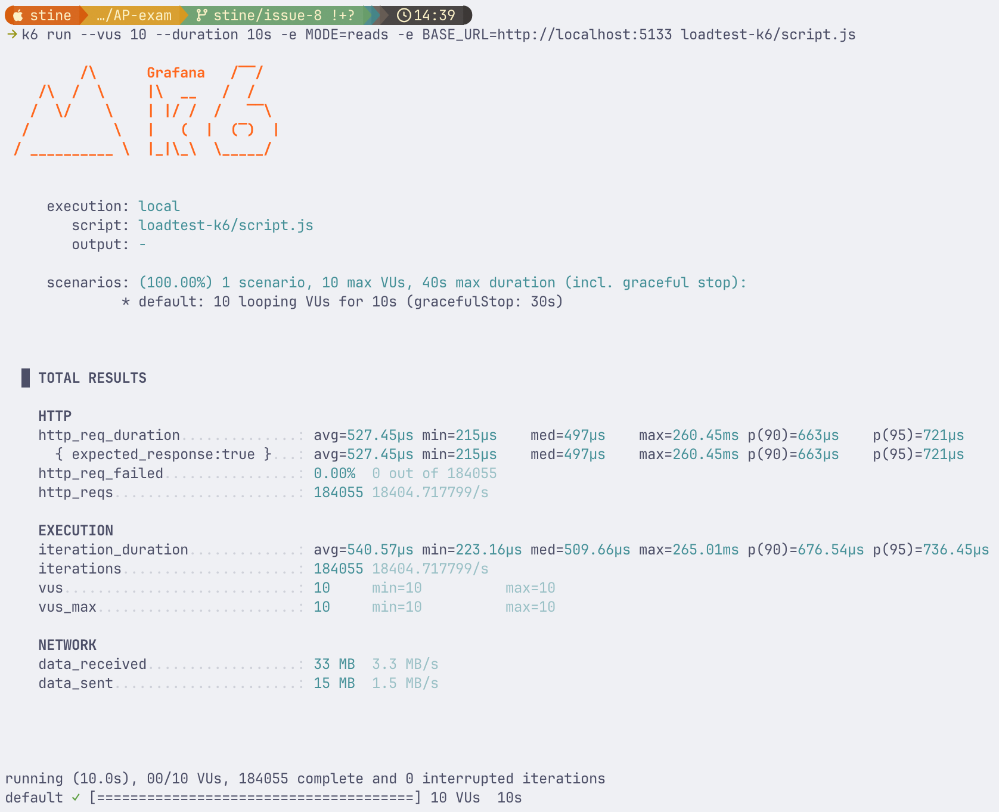
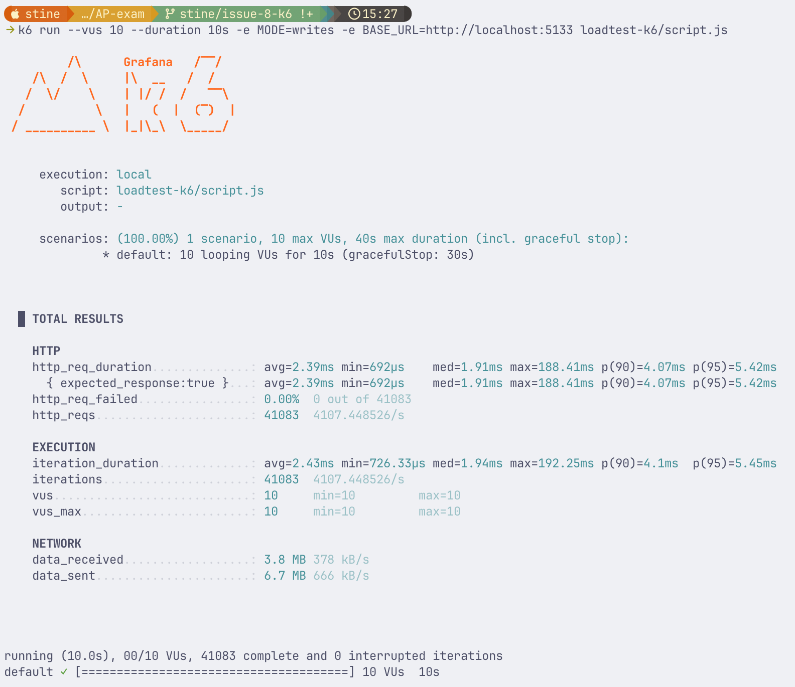

Start API'en.

Kør projektet med 10 workere der læser i 10 sekunder:
```
k6 run --vus 10 --duration 10s -e MODE=reads -e BASE_URL=http://localhost:XXXX loadtest-k6/script.js
```
Eksempel:


Kør projektet med 10 workere der skriver i 10 sekunder:
```
k6 run --vus 10 --duration 10s -e MODE=writes -e BASE_URL=http://localhost:XXXX loadtest-k6/script.js
```
Eksempel:
