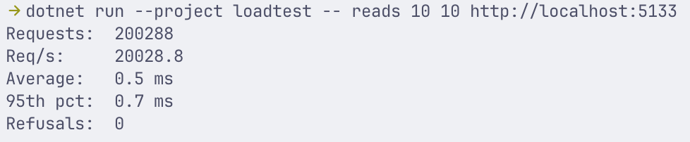
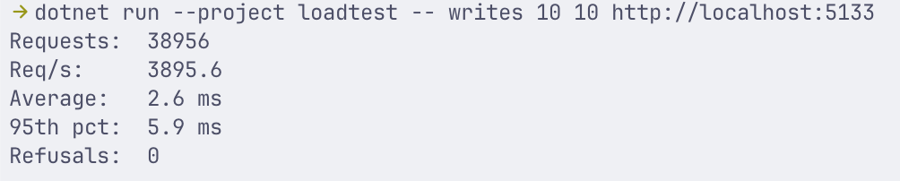

Start api'en.

Kør projektet med 10 workere der læser i 10 sekunder:
```
dotnet run --project loadtest -- reads 10 10
```
Eksempel:


Kør projektet med 10 workere der skriver i 10 sekunder:
```
dotnet run --project loadtest -- writes 10 10
```
Eksempel:
